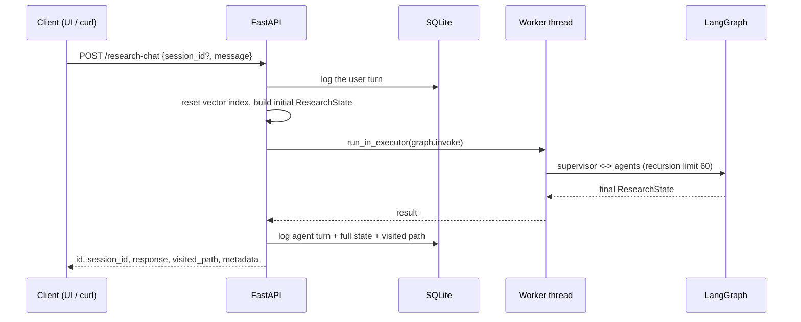

<div align="center">

# ResearchLLM: Multi-Agent Research Framework

**Autonomous literature discovery for scientists: every claim in the report is tied to a retrieved source, and the pipeline audits itself before answering.**

A FastAPI service around a LangGraph multi-agent pipeline, with persistent sessions and a full trace of every answer.

[](https://github.com/abhisakh/ResearchLLM_MultiAgent_LangGraph_RagGraph_Gemini/actions)


</div>

<!-- TODO: add live demo link and a short demo GIF here -->

<p align="center">
  
</p>

## Why this project

Researchers lose hours moving between databases, PDFs and search engines, and a general-purpose LLM answers from training data, not from the literature. ResearchLLM takes a different approach: it plans a search, pulls papers from scholarly sources, retrieves the most relevant passages from their full text, and writes a report that cites only what it retrieved. A separate evaluation agent then checks the report and can send the pipeline back for another pass.

It was built with materials-science and physics literature in mind (it includes a Materials Project tool), but the pipeline is domain-agnostic.

## How it works


The graph is hub-and-spoke: every agent hands control back to the supervisor, which reads the shared state and picks the next node. The supervisor is plain code, not an LLM, so routing is predictable and unit-tested without any API calls.

1. **Pre-tool reasoning.** Four agents clean the query, classify intent (research, material property, casual, out of scope), choose which tools are worth calling, and write a tiered query (strict → moderate → broad) for each tool.
2. **Tool execution.** Only the selected tools run. Results are normalised into a common format.
3. **Retrieval and RAG.** Full texts are downloaded and chunked. A FAISS bi-encoder search (top 30) is followed by cross-encoder reranking, neighbour-chunk expansion, de-duplication and keyword gating.
4. **Synthesis.** The report is generated from the filtered context with numbered citations.
5. **Evaluation and refinement.** The evaluation agent compares the report to the execution plan. If something is missing, it records a reason, and the supervisor jumps back to the matching stage (re-plan with more tools, re-extract PDFs, re-run RAG, or re-synthesise), for at most two refinement cycles.

The state shared by all agents (`ResearchState`) is saved for every turn, so any answer can be traced back to the path the graph took.

## The backend

The backend (`backend/`) is the core of the project. The Streamlit UI is a thin client: it only talks to the REST API, so any other client (a script, a notebook, another service) can use the pipeline the same way.



**Design highlights**

- **Async API over a synchronous graph.** The graph runs in a 5-worker thread pool via `run_in_executor`, so a long research query never blocks the event loop. A recursion limit of 60 is the hard stop against runaway loops.
- **Compile once, reuse.** The graph and the vector store are built at startup, and the health endpoint (`GET /`) reports whether the agent system initialised.
- **One typed state object.** `ResearchState` (a `TypedDict`) is the only thing agents exchange. There are no hidden side channels between them.
- **A common contract for tool agents.** `BaseToolAgent` is a template method: record the visit, run a guardrail (tool selected, queries available, valid input), then the tool logic. Every result is normalised to `{text, source_type, tool_id, metadata}`.
- **Incremental retrieval.** `RetrievalAgent` tracks processed documents by URL, so a refinement cycle downloads only the new ones.
- **Cosine-similarity vector store.** FAISS `IndexFlatIP` over L2-normalised vectors. Embeddings come from a local MiniLM model by default or from Gemini (with exponential back-off on rate limits). Duplicate chunk texts are skipped.
- **Every turn is traceable.** User turns, agent turns and errors are stored through SQLAlchemy, together with the full final graph state and the visited path. `GET /debug/raw-state/{id}` returns the stored state, and text is sanitised (surrogates stripped) before it is saved.
- **Clear failure modes.** `400` for an empty message, `503` while the system is not initialised, `500` for an agent failure, which is also logged as an `error` turn with its traceback.
- **Portable storage.** The SQLite path comes from `CHAT_DB_PATH` if set, then Cloud Run's persistent mount (`/mnt/db`), then a local file.

**Stored data (`chat_logs` table)**

| Column | Content |
|---|---|
| `id`, `session_id`, `timestamp` | Per-turn id, conversation id, UTC time |
| `role` | `user`, `agent` or `error` |
| `message` | The question, the report, or the error text |
| `tool_used` | Agent that produced the turn |
| `raw_data` | Full final `ResearchState` as JSON |
| `visited_nodes` | Ordered path the graph took, as JSON |

## Features

- **Supervisor-driven LangGraph workflow** with conditional routing and a bounded self-correction loop
- **Tiered, tool-specific query generation** rather than passing the raw user query to every API
- **Two-stage retrieval** over full-text papers, not just abstracts
- **FastAPI backend with session persistence,** per-turn state storage and a debug endpoint for any stored answer
- **Explainability tooling:** a state-inspection page and a live graph view with the visited path highlighted
- **LLMOps quality gates:** fast unit tests on every push, plus a weekly live end-to-end audit that checks report generation, citation integrity and graph-path coverage
- **Containerised** with Docker and docker-compose

## Tech stack

| Layer | Technology |
|---|---|
| Orchestration | LangGraph |
| LLM and embeddings | Google Gemini (`google-genai`, `langchain-google-genai`); local `all-MiniLM-L6-v2` embeddings by default |
| Retrieval | FAISS, sentence-transformers cross-encoder |
| Data sources | PubMed, ArXiv, OpenAlex, ChemRxiv, Materials Project, DuckDuckGo |
| Backend | FastAPI, Uvicorn, SQLAlchemy, SQLite |
| Frontend | Streamlit |
| Delivery | Docker, docker-compose, GitHub Actions, pytest |

## Quick start

**Requirements:** Python 3.12 and a [Gemini API key](https://aistudio.google.com/apikey). A [Materials Project key](https://next-gen.materialsproject.org/api) is needed only for material-property queries.

Create a `.env` file in the repository root (`cp .env.example .env`) and fill in your keys:

```bash
GEMINI_API_KEY=your-key
MP_API_KEY=your-key            # optional: Materials Project tool
EMBEDDING_PROVIDER=local       # "local" (default) or "gemini"
```

### Option A: Docker

```bash
docker compose up --build
```

- UI: http://localhost:8501
- API docs: http://localhost:8000/docs

Docker Compose keeps chat history in a named volume (`chat_data`); the FAISS index is rebuilt at startup.

### Option B: Local

```bash
python3 -m venv .venv && source .venv/bin/activate
pip install -r requirements.txt

# terminal 1, from the repository root
uvicorn backend.backend:app --reload

# terminal 2, from the repository root
streamlit run frontend/ui_main.py
```

Run both commands from the repository root: the backend imports its modules as `backend.*`.

## API

| Method | Endpoint | Description |
|---|---|---|
| `GET` | `/` | Health check: whether the agent graph initialised |
| `POST` | `/research-chat` | Run the full research graph for a message and log the turn |
| `GET` | `/chat-history/{session_id}` | All logged turns of a session |
| `GET` | `/list-sessions` | Stored sessions with a short preview |
| `GET` | `/graph-visualization` | Mermaid source of the compiled graph and a rendered image URL |
| `GET` | `/debug/raw-state/{message_id}` | Full stored `ResearchState` behind one answer |

Interactive docs are served at `/docs`. Example:

```bash
curl -X POST http://localhost:8000/research-chat \
  -H "Content-Type: application/json" \
  -d '{"message": "Thermal stability of CsPbI3 perovskites"}'
```

The response contains `id`, `session_id`, `response` (the report), `visited_path` (agents in the order they ran) and `metadata` (`refinement_retries`, `execution_time`). Pass the returned `session_id` in later requests to keep them in one conversation.

## Testing and CI

Tests come in two tiers:

```bash
python -m pytest                        # fast unit tests: no API keys, no network (default)
python -m pytest -m integration -s      # live end-to-end test: needs GEMINI_API_KEY
```

**Unit tests** (`tests/test_supervisor_routing.py`) cover the supervisor's routing decisions, the out-of-scope guardrail, the refinement loop and the rate-limit back-off, using stub agents.

The **integration test** (`tests/test_ai_rigor.py`) runs a real query end to end and asserts:

1. a non-trivial report is produced,
2. references are returned,
3. the graph visited more than a minimal set of nodes,
4. every citation number in the report maps to an existing reference,
5. a RAG utilisation ratio is reported.

Two GitHub Actions workflows run these tiers:

- `llmops_ci.yml` runs on every push and pull request: unit tests, then a Docker build. The image is pushed to Docker Hub only from the default branch.
- `llm_audit.yml` runs the live integration test weekly and on demand, and uploads the reasoning log as an artifact. It needs `GEMINI_API_KEY` (and optionally `MP_API_KEY`) as repository secrets.

## Project structure

```text
├── backend/
│   ├── agents/        # supervisor, planning, tools, RAG, synthesis, evaluation
│   ├── core/          # ResearchState, vector DB, utilities
│   ├── graph/         # LangGraph workflow definition
│   ├── backend.py     # FastAPI app
│   └── main.py        # headless entry point
├── frontend/          # Streamlit UI + debug and graph pages
├── tests/             # unit tests + live integration test
├── examples/          # sample outputs of each pipeline stage
├── .github/workflows/ # CI/CD
├── Dockerfile · docker-compose.yml
└── README_Detailed.md # full component-by-component documentation
```

## Limitations and roadmap

- **No benchmark yet.** Quality is checked by the CI gates above, not by a fixed evaluation set. A small benchmark (citation validity, groundedness, latency, cost per query) is the next planned addition.
- **One research query at a time.** All requests share a single vector index that is reset at the start of each request, so concurrent requests would interfere with each other. A per-request index is the fix.
- **The evaluation agent is an LLM judge,** so it reduces but does not remove unsupported claims.
- **Tools run in-process** as LangGraph nodes rather than over the Model Context Protocol. See [`MCP_Comparison.md`](./MCP_Comparison.md) for how the design compares and what a migration would involve.
- **The Semantic Scholar agent is unfinished:** it queries the API but does not yet store the results.
- **The API has no authentication or rate limiting, and CORS allows all origins,** so it should not be exposed publicly without hardening.
- **The vector store is a local FAISS index with pickled metadata,** which is fine for a single user but not for a shared deployment.

## More documentation

- [`README_Detailed.md`](./README_Detailed.md): full architecture, per-agent reference, state model, UI internals
- [`MCP_Comparison.md`](./MCP_Comparison.md): this system compared with the Model Context Protocol

## License

MIT, see [`LICENSE`](./LICENSE).
