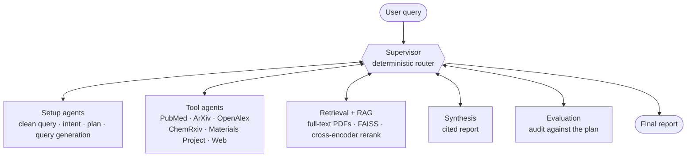

<div align="center">

# ResearchLLM: Multi-Agent Research Framework

**Autonomous literature discovery for scientists: every claim in the report is tied to a retrieved source, and the pipeline audits itself before answering.**

A FastAPI service around a LangGraph multi-agent pipeline, with persistent sessions and a full trace of every answer.

[](https://github.com/abhisakh/ResearchLLM_MultiAgent_LangGraph_RagGraph_Gemini/actions)


[3-minute walkthrough](https://gist.github.com/abhisakh/5ab2ec22d0a6ed06c4fc16ec47922882) · [Backend and API](docs/backend.md) · [Error handling](docs/error-handling.md) · [Testing and CI](docs/testing-and-ci.md) · [Security notes](docs/security.md) · [Benchmark](benchmarks/README.md)

</div>

<p align="center">
  
</p>

## Why this project

Researchers lose hours moving between databases, PDFs and search engines, and a general-purpose LLM answers from training data, not from the literature. ResearchLLM plans a search, pulls papers from scholarly sources, retrieves the most relevant passages from their full text, and writes a report that cites only what it retrieved. A separate evaluation agent then checks the report and can send the pipeline back for another pass.

It was built with materials-science and physics literature in mind (it includes a Materials Project tool), but the pipeline is domain-agnostic.

## How it works



The graph is hub-and-spoke: every agent hands control back to the supervisor, which reads the shared state and picks the next node. The supervisor is plain code, not an LLM, so routing is predictable and unit-tested without any API calls.

1. **Plan.** Agents clean the query, classify intent, choose the tools worth calling, and write a tiered query (strict → moderate → broad) for each. Out-of-scope questions skip the search entirely.
2. **Search.** Only the selected tools run, and their results are normalised into one format.
3. **Retrieve and filter.** Full texts are downloaded and chunked. FAISS search is followed by cross-encoder reranking, neighbour-chunk expansion, de-duplication and keyword gating.
4. **Write.** A synthesis agent drafts the report with numbered citations.
5. **Audit.** An evaluation agent checks the report against the plan. If something is missing, it names the stage that failed and the supervisor restarts from there, for at most two refinement cycles.

## Highlights

- **Deterministic supervisor** with a bounded self-correction loop
- **Two-stage retrieval** over full-text papers, not just abstracts
- **Typed error handling:** every Gemini failure is classified and gets its own response (retry, fallback model, agent fallback, or a clear stop). See [Error handling](docs/error-handling.md)
- **Traceable answers:** the full state and the path the agents took are stored for every turn, with a debug endpoint and a live graph view
- **LLMOps quality gates:** unit tests on every push, plus a weekly live end-to-end audit of citation integrity ([details](docs/testing-and-ci.md))
- **Containerised** with Docker and docker-compose

## Tech stack

| Layer | Technology |
|---|---|
| Orchestration | LangGraph |
| LLM and embeddings | Google Gemini (`google-genai`); local `all-MiniLM-L6-v2` embeddings by default |
| Retrieval | FAISS, sentence-transformers cross-encoder |
| Data sources | PubMed, ArXiv, OpenAlex, ChemRxiv, Materials Project, DuckDuckGo |
| Backend | FastAPI, Uvicorn, SQLAlchemy, SQLite |
| Frontend | Streamlit |
| Delivery | Docker, docker-compose, GitHub Actions, pytest |

## Quick start

**Requirements:** Python 3.12 or newer and a [Gemini API key](https://aistudio.google.com/apikey). A [Materials Project key](https://next-gen.materialsproject.org/api) is needed only for material-property queries.

Create a `.env` file in the repository root (`cp .env.example .env`) and fill in your keys:

```bash
GEMINI_API_KEY=your-key
MP_API_KEY=your-key            # optional: Materials Project tool
EMBEDDING_PROVIDER=local       # "local" (default) or "gemini"
LLM_MODEL_FALLBACKS=           # optional: models to try when the daily quota of LLM_MODEL is used up
```

**Docker:**

```bash
docker compose up --build
```

UI at http://localhost:8501, API docs at http://localhost:8000/docs. Chat history is kept in a named volume; the FAISS index is rebuilt at startup.

**Local** (two terminals, both from the repository root):

```bash
python3 -m venv .venv && source .venv/bin/activate
pip install -r requirements.txt

uvicorn backend.backend:app --reload     # terminal 1
streamlit run frontend/ui_main.py        # terminal 2
```

Try it from the command line:

```bash
curl -X POST http://localhost:8000/research-chat \
  -H "Content-Type: application/json" \
  -d '{"message": "Thermal stability of CsPbI3 perovskites"}'
```

The endpoints, response fields and stored data are described in [Backend and API](docs/backend.md).

## Limitations and roadmap

- **No benchmark results yet.** Quality is checked by CI gates and a weekly live audit, not a fixed evaluation set. A small benchmark ([`benchmarks/`](./benchmarks): time, Gemini requests, tokens, citation use and a lexical grounding score per question) is built and unit-tested, but has not been run on a real key yet.
- **One research query at a time.** Requests share a single vector index that is reset per request, so concurrent requests would interfere. A per-request index is the fix.
- **The evaluation agent is an LLM judge,** so it reduces but does not remove unsupported claims.
- **Tools run in-process** as LangGraph nodes rather than over the Model Context Protocol. See [`MCP_Comparison.md`](./MCP_Comparison.md).
- **Prompt injection is limited, not solved.** The model has no tools, routing and citations are checked by code, and the retrieval agent refuses private network addresses, but a retrieved page can still steer what the report says. See the [security notes](docs/security.md).
- **No authentication or rate limiting, and CORS allows all origins,** so do not expose the API publicly without hardening.
- **The vector store is a local FAISS index with pickled metadata,** fine for a single user but not for a shared deployment.

## More documentation

- [`docs/`](./docs): backend and API, error handling, testing and CI
- [`benchmarks/`](./benchmarks): fixed questions, a runner and the metrics (no published results yet)
- [`MCP_Comparison.md`](./MCP_Comparison.md): this system compared with the Model Context Protocol
- [`docs/archive-README_Detailed.md`](./docs/archive-README_Detailed.md): archived earlier write-up (predates the current design)

## License

MIT, see [`LICENSE`](./LICENSE).
