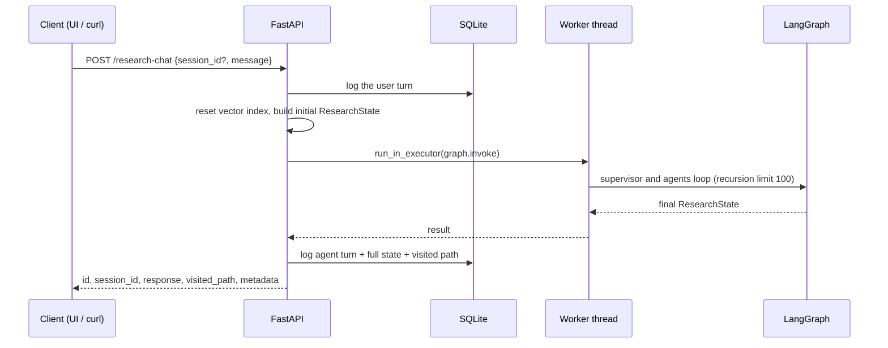

# Backend and API

[← Back to the README](../README.md)

The backend (`backend/`) is the core of the project. The Streamlit UI is a thin client: it only talks to the REST API, so any other client (a script, a notebook, another service) can use the pipeline the same way.



## Design highlights

- **Async API over a synchronous graph.** The graph runs in a 5-worker thread pool via `run_in_executor`, so a long research query never blocks the event loop. A recursion limit of 100 steps (one shared constant) is the last-resort ceiling: the supervisor's refinement cap and per-agent loop guard stop a runaway run long before that, and the longest healthy run needs about half of it.
- **Compile once, reuse.** The graph and the vector store are built at startup, and the health endpoint (`GET /`) reports whether the agent system initialised.
- **One typed state object.** `ResearchState` (a `TypedDict`) is the only thing agents exchange. There are no hidden side channels between them.
- **A common contract for tool agents.** `BaseToolAgent` is a template method: record the visit, run a guardrail (tool selected, queries available, valid input), then the tool logic. Every result is normalised to `{text, source_type, tool_id, metadata}`.
- **Incremental retrieval.** `RetrievalAgent` tracks processed documents by URL, so a refinement cycle downloads only the new ones.
- **Cosine-similarity vector store.** FAISS `IndexFlatIP` over L2-normalised vectors. Embeddings come from a local MiniLM model by default or from Gemini (with exponential back-off on rate limits). Duplicate chunk texts are skipped.
- **Every turn is traceable.** User turns, agent turns and errors are stored through SQLAlchemy, together with the full final graph state and the visited path. `GET /debug/raw-state/{id}` returns the stored state, and text is sanitised (surrogates stripped) before it is saved.
- **Errors are classified, not guessed.** A failed Gemini call is sorted into a kind from the SDK's structured error code, and each kind gets its own reaction. See [Error handling](error-handling.md).
- **Failures are reported, not hidden.** A run that cannot finish returns a specific HTTP status instead of a placeholder report, is stored as an `error` turn, and never exposes a traceback to the client (the traceback stays in the server log, next to an error ID the client can quote).
- **Portable storage.** The SQLite path comes from `CHAT_DB_PATH` if set, then Cloud Run's persistent mount (`/mnt/db`), then a local file.

## Stored data (`chat_logs` table)

| Column | Content |
|---|---|
| `id`, `session_id`, `timestamp` | Per-turn id, conversation id, UTC time |
| `role` | `user`, `agent` or `error` |
| `message` | The question, the report, or the error text |
| `tool_used` | Agent that produced the turn |
| `raw_data` | Full final `ResearchState` as JSON |
| `visited_nodes` | Ordered path the graph took, as JSON |

## API

| Method | Endpoint | Description |
|---|---|---|
| `GET` | `/` | Health check: whether the agent graph initialised |
| `POST` | `/research-chat` | Run the full research graph for a message and log the turn |
| `GET` | `/chat-history/{session_id}` | All logged turns of a session |
| `GET` | `/list-sessions` | Stored sessions with a short preview |
| `GET` | `/graph-visualization` | Mermaid source of the compiled graph and a rendered image URL |
| `GET` | `/debug/raw-state/{message_id}` | Full stored `ResearchState` behind one answer |

Interactive docs are served at `/docs`. Example:

```bash
curl -X POST http://localhost:8000/research-chat \
  -H "Content-Type: application/json" \
  -d '{"message": "Thermal stability of CsPbI3 perovskites"}'
```

The response contains `id`, `session_id`, `response` (the report), `visited_path` (agents in the order they ran) and `metadata`: `refinement_retries`, `execution_time` (seconds the run took), `evaluation_unavailable` (true when the evaluation agent could not review the report, so treat it as unchecked) and `degraded_agents` (agents that hit an LLM error and used their fallback). Pass the returned `session_id` in later requests to keep them in one conversation.

## Project structure

```text
├── backend/
│   ├── agents/        # supervisor, planning, tools, RAG, synthesis, evaluation
│   ├── core/          # ResearchState, vector DB, utilities, typed errors
│   ├── graph/         # LangGraph workflow definition
│   ├── backend.py     # FastAPI app
│   └── main.py        # headless entry point
├── frontend/          # Streamlit UI + debug and graph pages
├── tests/             # unit tests + live integration test
├── examples/          # sample outputs of each pipeline stage
├── docs/              # backend, error handling, testing and CI (plus an archived early write-up)
├── .github/workflows/ # CI/CD
└── Dockerfile · docker-compose.yml
```
